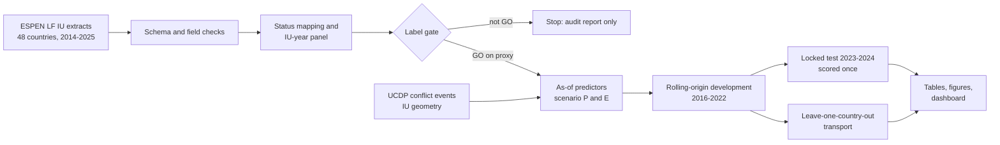

# Predicting interruptions of lymphatic filariasis mass drug administration in Africa

[](https://github.com/Isaac25-lgtm/lf-mda-interruption-prediction/actions/workflows/ci.yml)


A multi-country feasibility audit and prediction study using public WHO ESPEN
implementation-unit data, 2014-2025.

> **Read this first.** The outcome is a WHO-reported administrative status used as a
> proxy for a missed treatment round. No programme officer has reviewed the labels. The
> results describe what public data can and cannot predict. They are not validated for
> any programme decision and have not been peer reviewed.

## The question

Lymphatic filariasis (LF) is being eliminated through repeated rounds of mass drug
administration (MDA). When an implementation unit (IU, usually a district) misses a
round, elimination is delayed. Before the treatment year, a programme with limited
supervision capacity has to decide which IUs need extra attention.

**Among IUs with an active LF treatment programme, can information available at 31
December of year t-1 identify the units that will have a reported interruption in year
t, and does a statistical or machine-learning model do better than a simple rule based
on treatment history?**

## What is already known

| Source | What it did | What it left open |
|---|---|---|
| Fuller et al. 2023, [PLoS NTD](https://doi.org/10.1371/journal.pntd.0011146) | Explained coverage of 3,880 **delivered** LF rounds in 10 West African countries with rainfall, conflict, epidemics and programme maturity, using restricted data | Rounds that did not happen; prediction before the year; public data |
| Ng et al. 2025, [Trans R Soc Trop Med Hyg](https://doi.org/10.1093/trstmh/traf005) | Documented denominator, reporting and coverage problems in ESPEN using soil-transmitted helminthiasis data | Whether LF records share them |
| ESPEN Implementation Unit Planner | Shows IU-level funding status for planned MDA | No predictive model; not used here |

A dated search of PubMed, Europe PMC and GitHub found no study that predicts
non-delivery of an expected LF round at IU level and tests the prediction on later
years ([search log](docs/LITERATURE_SEARCH_LOG.md)). Several indexes were not searched,
so this is a defensible gap, not a proven first.

## What this study adds

1. **A label audit.** It separates reported non-delivery from non-reporting,
   never-started programmes, pauses for impact assessment and stops for surveillance,
   and measures how much of each is in the data.
2. **A clustering finding.** It shows how far interruptions are country-wide events
   rather than district-level failures, and what that does to the real sample size.
3. **A like-for-like comparison.** A fixed history rule, logistic regression and CatBoost are
   compared on later years and on countries left out of training, with uncertainty
   that respects country clustering.

## Results

<!-- RESULTS:START -->
*Generated by `lf-mda report` from the result files; gate decision `GO_ON_PROXY_LABEL`, independent information `LIMITED`, expert label review pending.*

- **Data:** 65,454 IU-year records, 48 country files, 6,236 implementation units, 2014-2025.
- **Primary cohort:** 8,795 IU-years with 1,839 reported interruptions in 32 countries (30 with at least one event).
- **Clustering:** 40% of interruptions occurred in country-years where every eligible IU missed the round; 61% of outcome variance lies between country-years.
- **Locked test (2023-2024):** 705 IU-years, 130 interruptions from 11 countries and 14 country-years.

No model has been evaluated.
<!-- RESULTS:END -->

Full tables: [`reports/tables/`](reports/tables). Figures:
[`reports/figures/`](reports/figures). Label audit:
[`reports/audit/label_audit.md`](reports/audit/label_audit.md).


## How it works



| Element | Choice |
|---|---|
| Unit | One IU in one year |
| Cohort | Required MDA at t-1, delivered in t-1 or t-2, fewer than 5 observed effective rounds |
| Outcome | ESPEN status "MDA not delivered" versus "under MDA" in year t |
| Excluded and counted | Pending impact assessment, surveillance, not reported, no record, contradictory |
| Predictors | IU treatment history; country and region programme history; conflict; population density |
| Scenario P / E | Records up to t-1 (programme) / up to t-2 (public ESPEN lag) |
| Approaches | Prevalence, country prior rate, fixed history rule, penalised logistic regression, CatBoost |
| Development | Rolling origin on 2016-2022; 2020-2021 reported as COVID-19 stress years |
| Primary test | 2023-2024, locked and scored once |
| Stress test | 2025 (funding shock, incomplete release) |
| Uncertainty | Bootstrap resampling whole countries; leave-one-country-out jackknife |

The protocol was frozen before any model was fitted
([`config/protocol.yaml`](config/protocol.yaml)); every later change is dated in
[`docs/DECISIONS.md`](docs/DECISIONS.md).

## Run it

```bash
git clone https://github.com/Isaac25-lgtm/lf-mda-interruption-prediction.git
cd lf-mda-interruption-prediction
python -m venv .venv
# Windows PowerShell:   .venv\Scripts\Activate.ps1
# Linux / macOS:        source .venv/bin/activate
python -m pip install -e ".[dev]"
python -m pytest -q

lf-mda download          # ESPEN extracts for all countries (about 6 minutes)
lf-mda context           # IU geometry and UCDP conflict events
lf-mda all               # audit, gate, models, evaluation, figures, dashboard data
streamlit run dashboard/app.py
```

`lf-mda all` stops before fitting any model if the label gate is not GO. Step-by-step
commands and run times are in [`docs/REPRODUCIBILITY.md`](docs/REPRODUCIBILITY.md).

## Dashboard

`streamlit run dashboard/app.py` opens a nine-page research dashboard: study overview
with an Africa map, data quality, IU map, risk explorer, model comparison, capacity
prioritisation, validation and uncertainty, methods, and limitations. It reads stored
results only and never trains a model. A public deployment does not exist yet; the
steps are in [`dashboard/README.md`](dashboard/README.md).

## Data

All data are open and need no registration.

| Source | Use | Redistributed here |
|---|---|---|
| [WHO ESPEN](https://espen.afro.who.int/maps-data/data-query-tools/download-data) LF IU-level data, 2014-2025 | Outcome and treatment history | No. Re-downloaded by script; checksums in `data/manifests/` |
| ESPEN IU geometry, 2024 provisional cartography | Centroids, areas, spatial joins | Centroids only |
| [UCDP GED 26.1](https://ucdp.uu.se/downloads/) (CC BY 4.0) | Conflict events | Derived counts only |

ESPEN states no licence on its download page. A small derived table in
`dashboard/data/` (IU names, status class, centroid, stored scores) is committed so the
dashboard can run; see [`docs/ETHICS_DATA_USE.md`](docs/ETHICS_DATA_USE.md) for the
reasoning and what to do if ESPEN objects.

## Limitations

1. The label is an unverified administrative proxy. Expert review is pending.
2. Before 2021 ESPEN had no status for "pending impact assessment", so some legitimate
   pauses may be counted as interruptions.
3. Most interruptions are country-wide, so the independent evidence is far smaller than
   the row count and intervals are wide.
4. Records are today's corrected values, not what was known at each decision date.
5. Programmes hold funding and planning information that is not used here.
6. Rainfall and travel-time predictors from the original concept were not used.
7. Nothing has been tested prospectively or with users.

More detail: [`docs/ISSUES.md`](docs/ISSUES.md).

## Repository map

| Path | Contents |
|---|---|
| `config/` | Frozen protocol, feature manifest, status map, data sources, release calendar |
| `src/lf_mda/` | Download, audit, labels, features, splits, models, evaluation, reporting |
| `tests/` | Unit, adversarial (leakage, label, split) and dashboard tests on synthetic data |
| `reports/audit/` | Label audit and gate decision |
| `reports/evaluation/` | Development, locked test, country transport, sensitivity, explanation |
| `reports/figures/`, `reports/tables/` | Publication figures and tables, generated by code |
| `dashboard/` | Streamlit app and its derived data |
| `docs/` | Status, decisions, label rules, predictor availability, literature, ethics, issues |
| `manuscript/` | Outline, captions, traceability, TRIPOD+AI tracker |

Current state and next steps: [`docs/STATUS.md`](docs/STATUS.md).

## Citation

Omoding I. *lf-mda-interruption-prediction* (research software, version 0.1.0), 2026.
https://github.com/Isaac25-lgtm/lf-mda-interruption-prediction. See
[`CITATION.cff`](CITATION.cff). Affiliation to be confirmed.

Please also cite the data sources: WHO ESPEN (https://espen.afro.who.int) and the
Uppsala Conflict Data Program.

## Licence

Code: MIT ([`LICENSE`](LICENSE)). The licence does not cover WHO ESPEN data or any
other third-party material.

## Contact

Open an issue on this repository. See [`CONTRIBUTING.md`](CONTRIBUTING.md).
