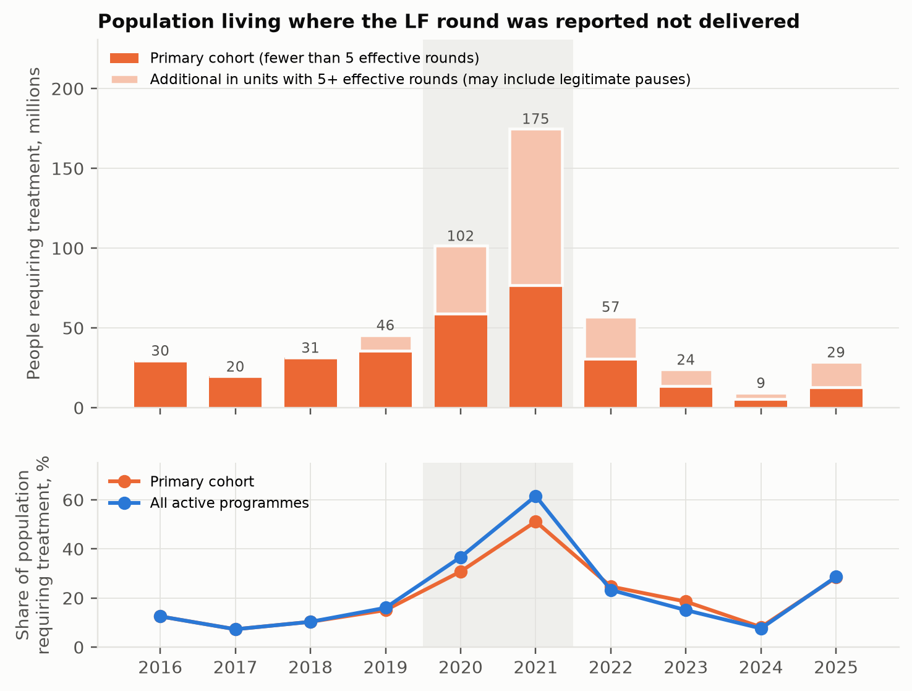
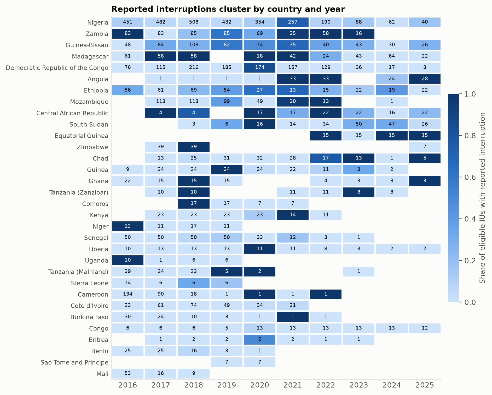
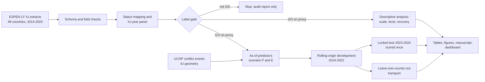

# Missed rounds of lymphatic filariasis mass drug administration in Africa

**Scale, country-level clustering, recovery, and the limits of district-level prediction
from public WHO ESPEN data, 2014-2025.**

[](https://github.com/Isaac25-lgtm/lf-mda-interruption-prediction/actions/workflows/ci.yml)


[](https://lf-mda-interruption-prediction-kubq9wrtrramveajwfh8qg.streamlit.app/)

**Live dashboard:** https://lf-mda-interruption-prediction-kubq9wrtrramveajwfh8qg.streamlit.app/

**Taking over this project?** Start with [`docs/HANDOVER.md`](docs/HANDOVER.md): what was
attempted, every model trained, why none beat a simple rule, and what to do next.

> **Read this first.** The outcome is a WHO-reported administrative status used as a
> proxy for a missed treatment round. No programme officer has reviewed the labels.
> The results describe what public data show and what they cannot predict. They are
> not validated for any programme decision and have not been peer reviewed.

## The question

Lymphatic filariasis (LF) is being eliminated through repeated rounds of mass drug
administration (MDA). When an implementation unit (IU, usually a district) misses a
round, elimination is delayed. This study asks, across all African countries with
public ESPEN data:

1. **How often are rounds missed, and how many people live where they are missed?**
2. **Are missed rounds local failures or country-wide ones?**
3. **What happens afterwards?**
4. **Can information available at 31 December of year t-1 identify the IUs that will
   miss the round in year t, and does a statistical or machine-learning model do
   better than a simple rule based on treatment history?**

The study began as question 4 alone. The audit of the data and the test results showed
that the first three questions carry the stronger findings, so the paper is now built
around them, with the prediction test reported exactly as pre-specified
([decision D20](docs/DECISIONS.md)).

## What is already known

| Source | What it did | What it left open |
|---|---|---|
| Fuller et al. 2023, [PLoS NTD](https://doi.org/10.1371/journal.pntd.0011146) | Explained coverage of 3,880 **delivered** LF rounds in 10 West African countries with rainfall, conflict, epidemics and programme maturity, using restricted data | Rounds that did not happen; prediction before the year; public data |
| Ng et al. 2025, [Trans R Soc Trop Med Hyg](https://doi.org/10.1093/trstmh/traf005) | Documented denominator, reporting and coverage problems in ESPEN using soil-transmitted helminthiasis data | Whether LF records share them |
| ESPEN Implementation Unit Planner | Shows IU-level funding status for planned MDA | No predictive model; not used here |

A dated search of PubMed, Europe PMC and GitHub found no study that describes or
predicts non-delivery of expected LF rounds at IU level across countries
([search log](docs/LITERATURE_SEARCH_LOG.md)). Several indexes were not searched, so
this is a defensible gap, not a proven first.

## What this study adds

1. **A label audit.** It separates reported non-delivery from non-reporting,
   never-started programmes, pauses for impact assessment and stops for surveillance,
   and measures how much of each is in the data.
2. **The anatomy of interruptions.** Population affected by year and country, the share
   of failures that are country-wide, and how quickly treatment resumes.
3. **A tested negative result.** A fixed history rule, logistic regression and CatBoost
   are compared on later years and on countries left out of training, with uncertainty
   that respects country clustering. No model improves on the rule.

## Results

<!-- RESULTS:START -->
*Generated by `lf-mda report` from the result files; gate decision `GO_ON_PROXY_LABEL`, independent information `LIMITED`, expert label review pending.*

- **Data:** 65,454 IU-year records, 48 country files, 6,236 implementation units, 2014-2025.
- **Primary cohort:** 8,795 IU-years with 1,839 reported interruptions in 32 countries (30 with at least one event).
- **Clustering:** 40% of interruptions occurred in country-years where every eligible IU missed the round; 61% of outcome variance lies between country-years.
- **Locked test (2023-2024):** 705 IU-years, 130 interruptions from 11 countries and 14 country-years.
- **Scale:** in 2021, IUs with a reported interruption held 77 million people requiring treatment (51% of the cohort's population requiring treatment), and 175 million across all active programmes. The figures for 2024 and 2025 were 5 million and 13 million.
- **Recovery:** after an interruption that began in 2016-2019, 55% of IUs resumed MDA within one year and 75% within three. 23% of IUs had two or more interruptions and accounted for 69% of all interruptions.
- **Country persistence:** a country where most IUs missed the round did so again the next year in 32% of cases, against 19% otherwise.

**Locked test 2023-2024, scenario P (95% country-cluster bootstrap intervals):**

| Approach | AUROC | AUROC within country-year | Captured in top 20% |
|---|---|---|---|
| Country prior rate | 0.59 (0.39 to 0.81) | 0.50 (0.50 to 0.50) | 0.36 (0.12 to 0.63) |
| History rule | 0.65 (0.43 to 0.82) | 0.50 (0.25 to 0.81) | 0.48 (0.20 to 0.68) |
| Logistic, five predictors | 0.66 (0.44 to 0.81) | 0.68 (0.11 to 0.85) | 0.42 (0.14 to 0.63) |
| Logistic, IU history only | 0.64 (0.43 to 0.79) | 0.67 (0.17 to 0.84) | 0.38 (0.13 to 0.59) |
| Logistic, programme history | 0.67 (0.48 to 0.81) | 0.68 (0.19 to 0.83) | 0.41 (0.17 to 0.59) |
| Logistic, history + context | 0.56 (0.32 to 0.76) | 0.65 (0.18 to 0.80) | 0.18 (0.02 to 0.47) |
| CatBoost, programme history | 0.62 (0.35 to 0.81) | 0.70 (0.22 to 0.86) | 0.27 (0.01 to 0.50) |
| CatBoost, history + context | 0.59 (0.33 to 0.78) | 0.69 (0.23 to 0.84) | 0.25 (0.00 to 0.49) |
| CatBoost, history + country ID | 0.56 (0.31 to 0.77) | 0.73 (0.20 to 0.88) | 0.16 (0.00 to 0.44) |

**Pre-specified test of improvement over the history rule: not met.** The primary candidate, chosen on development folds by pooled log loss, was Logistic, IU history only. Its share of interruptions captured at 20% capacity differed from the history rule by -0.100 (-0.291 to 0.097). The criterion was a gain of at least 0.05 with a 95% interval above zero.
None of the other 6 approaches cleared that criterion either (exploratory, no adjustment for multiple comparisons).

**Scenario E (public data only, two-year lag), same IU-years:**

| Approach | AUROC | AUROC within country-year | Captured in top 20% |
|---|---|---|---|
| Country prior rate | 0.50 (0.32 to 0.72) | 0.50 (0.50 to 0.50) | 0.19 (0.04 to 0.43) |
| History rule | 0.45 (0.24 to 0.65) | 0.63 (0.39 to 0.70) | 0.20 (0.05 to 0.39) |
| Logistic, five predictors | 0.53 (0.31 to 0.71) | 0.65 (0.15 to 0.82) | 0.26 (0.05 to 0.43) |
| Logistic, IU history only | 0.51 (0.31 to 0.69) | 0.55 (0.20 to 0.70) | 0.20 (0.03 to 0.42) |
| Logistic, programme history | 0.55 (0.34 to 0.73) | 0.58 (0.16 to 0.76) | 0.31 (0.07 to 0.50) |
| Logistic, history + context | 0.46 (0.24 to 0.69) | 0.55 (0.14 to 0.73) | 0.03 (0.00 to 0.47) |
| CatBoost, programme history | 0.60 (0.40 to 0.72) | 0.61 (0.36 to 0.74) | 0.24 (0.04 to 0.44) |
| CatBoost, history + context | 0.54 (0.30 to 0.69) | 0.62 (0.33 to 0.75) | 0.24 (0.02 to 0.44) |
| CatBoost, history + country ID | 0.52 (0.27 to 0.73) | 0.67 (0.40 to 0.81) | 0.15 (0.00 to 0.44) |

**2025 stress year, scenario P (robustness only, not part of the primary test):**

| Approach | AUROC | AUROC within country-year | Captured in top 20% |
|---|---|---|---|
| Country prior rate | 0.73 (0.35 to 0.93) | 0.50 (0.50 to 0.50) | 0.35 (0.00 to 0.65) |
| History rule | 0.85 (0.62 to 0.95) | 0.77 (0.32 to 0.91) | 0.52 (0.08 to 0.65) |
| Logistic, five predictors | 0.78 (0.42 to 0.91) | 0.51 (0.12 to 0.90) | 0.47 (0.02 to 0.63) |
| Logistic, IU history only | 0.77 (0.48 to 0.90) | 0.62 (0.12 to 0.80) | 0.43 (0.06 to 0.60) |
| Logistic, programme history | 0.77 (0.46 to 0.91) | 0.62 (0.11 to 0.84) | 0.45 (0.05 to 0.61) |
| Logistic, history + context | 0.70 (0.38 to 0.88) | 0.63 (0.12 to 0.83) | 0.30 (0.00 to 0.56) |
| CatBoost, programme history | 0.65 (0.36 to 0.84) | 0.65 (0.06 to 0.94) | 0.31 (0.00 to 0.49) |
| CatBoost, history + context | 0.63 (0.32 to 0.83) | 0.66 (0.00 to 0.96) | 0.25 (0.00 to 0.45) |
| CatBoost, history + country ID | 0.74 (0.41 to 0.93) | 0.61 (0.12 to 0.84) | 0.32 (0.00 to 0.62) |

**Exploratory, post hoc.** After the locked test was opened, three further approaches built around the country-level structure of the data were tried (a within/between-country logistic model, a country-then-district ranking, and the history rule with a term for fewer cumulative rounds). They were designed with knowledge of the test results, so they prove nothing; 0 of 3 cleared the improvement criterion. See `reports/tables/tableX_exploratory_posthoc.md`.

**Countries excluded from training (leave-one-country-out, development years 2016-2022; 20 of 32 countries have enough events and non-events for a country-specific estimate):**

| Approach | AUROC | AUROC within country-year | Captured in top 20% |
|---|---|---|---|
| Country prior rate | 0.59 (0.48 to 0.71) | 0.50 (0.50 to 0.50) | 0.29 (0.14 to 0.41) |
| History rule | 0.59 (0.47 to 0.67) | 0.69 (0.62 to 0.75) | 0.33 (0.25 to 0.41) |
| Logistic, IU history only | 0.68 (0.59 to 0.75) | 0.64 (0.35 to 0.66) | 0.38 (0.28 to 0.45) |
| Logistic, programme history | 0.57 (0.47 to 0.66) | 0.70 (0.36 to 0.73) | 0.29 (0.17 to 0.37) |
| CatBoost, programme history | 0.59 (0.45 to 0.69) | 0.66 (0.36 to 0.72) | 0.34 (0.23 to 0.45) |

<!-- RESULTS:END -->

### Why the prediction work stops here

Every planned stage was completed. The prediction work stops for a scientific reason,
not because it was left unfinished:

- The success criterion was fixed before any model was fitted, and no model met it.
- Most interruptions are country-wide shocks that do not repeat from year to year, so
  a district's own history cannot predict them.
- What does drive them (funding, medicine supply, campaign plans) is not in public
  ESPEN data.
- In two rounds of tuning, every model did best when shrunk towards "predict the
  average". More modelling on the same data would only add models, not information.

The simple rule did at least as well as every model, but it was not shown to be
better: the test has too few independent country-years to separate them. The full
account, with the evidence for each reason and the next steps that could change the
answer, is in [`docs/HANDOVER.md`](docs/HANDOVER.md).

Full tables: [`reports/tables/`](reports/tables). Figures:
[`reports/figures/`](reports/figures). Label audit:
[`reports/audit/label_audit.md`](reports/audit/label_audit.md). Manuscript draft:
[`manuscript/manuscript_draft.md`](manuscript/manuscript_draft.md).





## How it works



| Element | Choice |
|---|---|
| Unit | One IU in one year |
| Cohort | Required MDA at t-1, delivered in t-1 or t-2, fewer than 5 observed effective rounds |
| Outcome | ESPEN status "MDA not delivered" versus "under MDA" in year t |
| Excluded and counted | Pending impact assessment, surveillance, not reported, no record, contradictory |
| Predictors | IU treatment history; country and region programme history; conflict; population density |
| Scenario P / E | Records up to t-1 (programme) / up to t-2 (public ESPEN lag) |
| Approaches | Prevalence, country prior rate, fixed history rule, four penalised logistic models, three CatBoost models |
| Development | Rolling origin on 2016-2022; 2020-2021 reported as COVID-19 stress years |
| Primary test | 2023-2024, locked and scored once |
| Stress test | 2025 (funding shock, incomplete release) |
| Uncertainty | Bootstrap resampling whole countries; leave-one-country-out jackknife |
| After the test | Three further models, labelled exploratory and post hoc |

The protocol was frozen before any model was fitted
([`config/protocol.yaml`](config/protocol.yaml)); every later change is dated in
[`docs/DECISIONS.md`](docs/DECISIONS.md).

## Run it

```bash
git clone https://github.com/Isaac25-lgtm/lf-mda-interruption-prediction.git
cd lf-mda-interruption-prediction
python -m venv .venv
# Windows PowerShell:   .venv\Scripts\Activate.ps1
# Linux / macOS:        source .venv/bin/activate
python -m pip install -e ".[dev]"
python -m pytest -q

lf-mda download          # ESPEN extracts for all countries (about 6 minutes)
lf-mda context           # IU geometry and UCDP conflict events
lf-mda all               # audit, gate, description, models, evaluation, figures, manuscript
streamlit run dashboard/app.py
```

`lf-mda all` stops before fitting any model if the label gate is not GO. Step-by-step
commands and run times are in [`docs/REPRODUCIBILITY.md`](docs/REPRODUCIBILITY.md).

## Dashboard

`streamlit run dashboard/app.py` opens a ten-page research dashboard: study overview
with an Africa map; scale, level and recovery; data quality; IU map; risk explorer;
model comparison; capacity prioritisation; validation and uncertainty; methods; and
limitations. It reads stored results only and never trains a model.

It is hosted on Streamlit Community Cloud at https://lf-mda-interruption-prediction-kubq9wrtrramveajwfh8qg.streamlit.app/
and redeploys on every push to `main`. No model is served as a live prediction
service; the dashboard shows stored research results. Deployment notes are in
[`dashboard/README.md`](dashboard/README.md).

## Data

All data are open and need no registration.

| Source | Use | Redistributed here |
|---|---|---|
| [WHO ESPEN](https://espen.afro.who.int/maps-data/data-query-tools/download-data) LF IU-level data, 2014-2025 | Outcome and treatment history | No. Re-downloaded by script; checksums in `data/manifests/` |
| ESPEN IU geometry, 2024 provisional cartography | Centroids, areas, spatial joins | Centroids only |
| [UCDP GED 26.1](https://ucdp.uu.se/downloads/) (CC BY 4.0) | Conflict events | Derived counts only |

ESPEN states no licence on its download page. A small derived table in
`dashboard/data/` (IU names, status class, centroid, stored scores) is committed so the
dashboard can run; see [`docs/ETHICS_DATA_USE.md`](docs/ETHICS_DATA_USE.md) for the
reasoning and what to do if ESPEN objects.

## Limitations

1. The label is an unverified administrative proxy. Expert review is pending.
2. Before 2021 ESPEN had no status for "pending impact assessment", so some legitimate
   pauses may be counted as interruptions. Population figures for all active programmes
   are upper bounds for that reason.
3. Most interruptions are country-wide, so the independent evidence for comparing
   models is far smaller than the row count and intervals are wide. "No improvement
   found" is not proof that none exists.
4. Records are today's corrected values, not what was known at each decision date.
5. Programmes hold funding and planning information that is not used here.
6. Rainfall and travel-time predictors from the original concept were not used.
7. Predicted probabilities were poorly calibrated on the test years.
8. Nothing has been tested prospectively or with users.

More detail: [`docs/ISSUES.md`](docs/ISSUES.md). Assessment against the project's ten
publication standards: [`docs/PUBLICATION_STANDARDS.md`](docs/PUBLICATION_STANDARDS.md).

## Repository map

| Path | Contents |
|---|---|
| `config/` | Frozen protocol, feature manifest, status map, data sources, release calendar |
| `src/lf_mda/` | Download, audit, labels, description, features, splits, models, evaluation, reporting |
| `tests/` | Unit, adversarial (leakage, label, split) and dashboard tests on synthetic data |
| `reports/audit/` | Label audit and gate decision |
| `reports/descriptive/` | Burden, level and recovery tables |
| `reports/evaluation/` | Development (both rounds), locked test, country transport, sensitivity, explanation, exploratory |
| `reports/figures/`, `reports/tables/` | Publication figures and tables, generated by code |
| `manuscript/` | Template, generated draft, captions, traceability, TRIPOD+AI tracker |
| `dashboard/` | Streamlit app and its derived data |
| `docs/` | Handover, status, decisions, label rules, predictor availability, literature, ethics, issues |

Current state and next steps: [`docs/STATUS.md`](docs/STATUS.md).

## Citation

Omoding I. *lf-mda-interruption-prediction* (research software, version 0.1.0), 2026.
https://github.com/Isaac25-lgtm/lf-mda-interruption-prediction. See
[`CITATION.cff`](CITATION.cff). Affiliation to be confirmed.

Please also cite the data sources: WHO ESPEN (https://espen.afro.who.int) and the
Uppsala Conflict Data Program.

## Licence

Code: MIT ([`LICENSE`](LICENSE)). The licence does not cover WHO ESPEN data or any
other third-party material.

## Contact

Open an issue on this repository. See [`CONTRIBUTING.md`](CONTRIBUTING.md).
